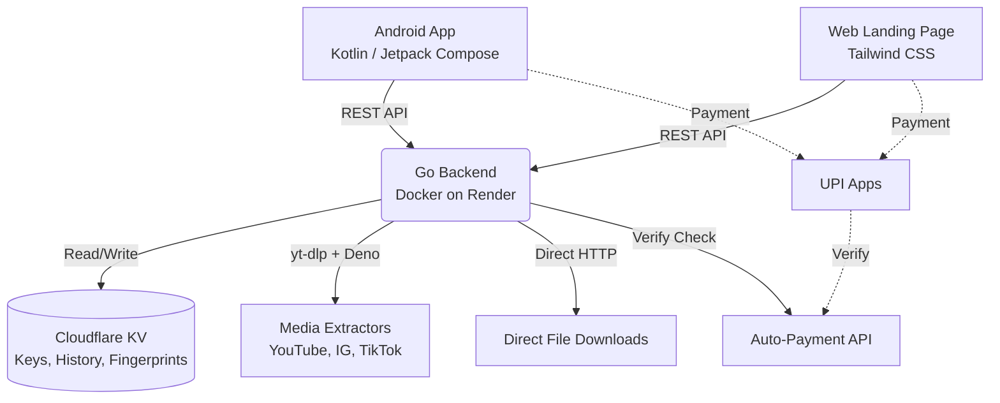

<div align="center">
  <h1>Pluck</h1>
  <p>
    <strong>Pull any media from anywhere.</strong>
    <br />
    A high-performance, open-source Android media downloader with a self-hostable Go backend.
  </p>

  <p>
    <a href="https://github.com/realximanta/Pluck/actions/workflows/release.yml"></a>
    <a href="https://github.com/realximanta/Pluck/releases"></a>
    <a href="https://pluck.ximanta.xyz"></a>
    <a href="https://github.com/realximanta/Pluck/blob/main/LICENSE"></a>
  </p>

  <p>
    <a href="https://kotlinlang.org"></a>
    <a href="https://go.dev"></a>
    <a href="https://www.docker.com"></a>
    <a href="https://workers.cloudflare.com"></a>
  </p>
  
  <br />
</div>

## 📖 Overview

**Pluck** is a full-stack media extraction engine. It consists of a native Android app built with Jetpack Compose and a Dockerized Go backend running `yt-dlp` and `ffmpeg`. 

Whether it's a 4K YouTube video, a TikTok audio track, an Instagram Reel, or a direct PDF link, Pluck fetches the media, allows you to choose the exact format and quality, and downloads it straight to your device's public storage folders.

## ✨ Core Features

- 🌍 **Universal Resolver:** Handles 50+ platforms (YouTube, Instagram, TikTok, Facebook, Pinterest), cloud drives (Google Drive, Dropbox, MediaFire), direct file URLs, and HTML pages with embedded media.
- 📺 **Format & Quality Selection:** Preview every available format before downloading. Choose 144p to 4K video, audio-only streams, or muxed files.
- 📂 **Public Storage:** Downloads bypass the Android `data/` folder. Files are organized into `Movies/Pluck`, `Music/Pluck`, and `Pictures/Pluck` using the `MediaStore` API.
- 🔐 **Key-Based Auth:** Secure 10-character API keys (alphanumeric, no `O/0/I/1` confusion). 
- 💳 **UPI Payment Integration:** Native QR generation with exact paise fingerprinting. The backend verifies the payment via the Auto-Payment API before issuing a key.
- 🛡️ **Hardened Security:**
  - Cloudflare Turnstile CAPTCHA on the web checkout.
  - SSRF protection blocking private and loopback IPs.
  - Strict regex validation on `yt-dlp` arguments to prevent command injection.
  - HttpOnly admin cookies to prevent XSS token theft.
- 🚀 **Automated CI/CD:** Publishing a GitHub Release automatically bumps the `versionCode`, injects the production API URL, builds a signed APK, and updates the landing page.

## 🏗️ Architecture



## 🚀 Quick Start (User)

1. Go to the [Releases](https://github.com/realximanta/Pluck/releases) page.
2. Download the latest `pluck-vX.Y.Z.apk`.
3. Install the APK on your Android device (API 26+).
4. Purchase a key from [pluck.ximanta.xyz](https://pluck.ximanta.xyz), or generate one from the Admin Panel.
5. Paste the key into the app and start pulling.

## 🛠️ Quick Start (Developer)

### Backend (Docker)

The backend requires Docker to run `yt-dlp`, `ffmpeg`, and `Deno` (required for YouTube extraction).

```bash
cd backend
docker build -t pluck-server .
docker run -p 8080:8080 \
  -e CF_ACCOUNT_ID=your_id \
  -e CF_API_TOKEN=your_token \
  -e CF_KV_NAMESPACE_ID=your_kv_id \
  -e ADMIN_KEY=your_secret_admin_key \
  -e AUTOPAY_KEY=your_autopay_key \
  -e AUTOPAY_UPI=yourname@fam \
  -e AUTOPAY_BOT_NAME=Pluck \
  -e TURNSTILE_SECRET_KEY=your_turnstile_secret \
  pluck-server
```

### Environment Variables

| Variable | Required | Description |
|----------|----------|-------------|
| `CF_ACCOUNT_ID` | ✅ | Cloudflare account ID |
| `CF_API_TOKEN` | ✅ | Cloudflare API token with KV edit permissions |
| `CF_KV_NAMESPACE_ID` | ✅ | Cloudflare KV Namespace ID |
| `ADMIN_KEY` | ✅ | Password for the `/admin` panel |
| `AUTOPAY_KEY` | ✅ | Auto-Payment API key |
| `AUTOPAY_UPI` | ✅ | Merchant UPI ID |
| `AUTOPAY_BOT_NAME` | ✅ | Display name for the UPI app |
| `TURNSTILE_SECRET_KEY` | ⚠️ | Cloudflare Turnstile Secret (required for web) |
| `PUBLIC_BASE_URL` | ⚠️ | Production URL (e.g., `https://pluck.ximanta.xyz`) |

### App (Android)

```bash
# Build the debug APK
./gradlew :app:assembleDebug

# Build the signed release APK (requires KEYSTORE_* secrets)
./gradlew :app:assembleRelease
```

## 🔐 Security & Licensing

- **License:** MIT (See [LICENSE](https://github.com/realximanta/Pluck/blob/main/LICENSE))
- **Author:** [Ximanta](https://github.com/realximanta)
- **Support:** official@ximanta.xyz

<div align="center">
  <br />
  <i>Pluck · Better Call Tuku</i>
</div>
